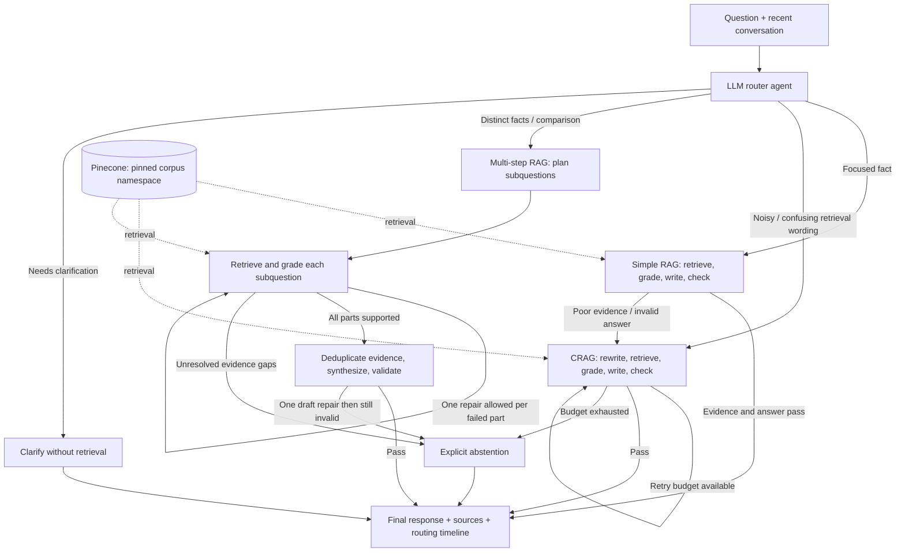

# ChaiTech RAG Strategy Lab

An application that uses an LLM router to choose between **Simple RAG, Corrective RAG (CRAG), and Multi-step RAG**. It retrieves from **Pinecone**, generates source-backed answers, validates evidence and answers, and records routing decisions in **LangSmith**. Each strategy is a separate **LangGraph subgraph**, with LangChain model adapters, structured outputs, runnables, callbacks, and text splitting.

The key behavior is observable escalation: a question may start with Simple RAG, but poor retrieved evidence or failed answer validation automatically sends it to CRAG. The interface reports the **initial strategy, final strategy, and reason for the change**.

The bundled ChaiTech policies are fictional and cover annual leave, remote work, learning expenses, business travel, and security reporting.

## Project coverage

| Requirement | Implementation |
|---|---|
| At least three distinct RAG strategies | `SimpleRAG`, `CorrectiveRAG`, and `MultiStepRAG` subgraphs in [rag_app/engine.py](rag_app/engine.py) |
| Intelligent router agent | Structured `RouteDecision` generated from the question and recent history |
| Simple questions use Normal RAG | One retrieval/grade/write/check pass |
| Poor retrieval triggers correction | Runtime grader/check feedback escalates Simple RAG to CRAG |
| Complex questions use agentic/multi-step RAG | LLM decomposition, separate subquestion retrieval, evidence collection, and synthesis |
| Vector storage and retrieval | Official Pinecone SDK, external embeddings, source/corpus metadata filters |
| LangChain and LangGraph | Typed model calls, runnable entry point, callbacks, splitter, router and strategy graphs |
| LangSmith tracing | Named root/strategy/node/retrieval/model spans and conversation metadata |
| Explain why each query took its route | UI event timeline, route reason, initial/final strategy, demo scenarios |
| Submission documentation | This README, [formal notes](FormalNotes.md), test evidence, architecture diagrams |

## Architecture



The exact diagrams exported from the compiled graphs are in [design/graphs.md](design/graphs.md). [FormalNotes.md](FormalNotes.md) defines all seven strategy types named in the Project and distinguishes them from the three implemented here.

### The three implementations

| Strategy | What actually changes | Default retrieval budget |
|---|---|---|
| Simple RAG | One focused retrieve/grade/write/check pass; no internal query rewrite | One search, then optional parent-level escalation |
| CRAG | Rewrite using failure feedback; retrieve and grade again; generate only when evidence is sufficient | Two corrective searches; up to three total when Simple ran first |
| Multi-step RAG | Plan 2–4 complementary subquestions; retrieve/grade each; combine evidence; synthesize/check one answer | At most two searches per subquestion; at most eight total |

Multi-step permits one search repair per failed subquestion and one additional synthesis draft if final validation fails. Unresolved evidence gaps cause abstention. Provider retries and structured-output formatting repairs are separate from retrieval budgets.

These are different algorithms, not three names for the same chain. Hybrid RAG, Multi-Query RAG, original Self-RAG, and knowledge-graph RAG are explained in the notes but are **not claimed as additional implemented strategies**. LangGraph orchestration does not make this Graph RAG.

## Project structure

```text
rag_app/
  config.py           Configuration and Euri AI model/embedding clients
  schemas.py          Typed API and model output contracts
  pinecone_store.py   Chunking, index validation, versioned ingestion, retrieval
  llm.py              Router, grader, rewrite, plan, generation, and check prompts
  engine.py           Parent router + three compiled strategy subgraphs
  citations.py        Source resolution and deterministic marker rendering
  store.py            SQLite manifest, persistent history, completed-request cache
  service.py          Runnable entry point, session coordination, tracing and usage
server.py             Authenticated FastAPI endpoints and browser UI
ingest.py             Explicit Pinecone ingestion command
manage.py             App-token setup and retention cleanup
run_demo.py           Execute 18 labeled scenarios and record actual outputs
demo_queries.json     Questions, routing expectations, source/fact checks
docs/                 Only the five fictional policy documents for ingestion
design/graphs.md      Diagrams generated from the actual graphs
static/               Same-origin browser UI
tests/                Strategy, storage, citation, API, and Pinecone-adapter tests
artifacts/            Verification evidence; private live results are Git-ignored
FormalNotes.md        Detailed academic definitions and comparisons
```

## Setup

### 1. Install dependencies

Use Python **3.13** and run commands from this folder:

```powershell
python -m venv .venv
.\.venv\Scripts\python.exe -m pip install -r requirements-dev.txt
```


### 2. Add your Pinecone API key

The prepared local folder contains an ignored `.env` populated with your existing Azure/LangSmith configuration. **`PINECONE_API_KEY` is deliberately blank.** Add your Pinecone key there before ingestion.
 Fill the remaining cloud settings yourself when using a fresh clone. Never commit `.env` or `secrets/`.

| Variable | Purpose |
|---|---|
| `PINECONE_API_KEY` | Pinecone project API key with permissions for the required index operations |
| `PINECONE_INDEX_NAME` | Dedicated dense index; default `chaitech-rag-strategies` |
| `PINECONE_CLOUD`, `PINECONE_REGION` | Serverless location when creating a new index; defaults `aws`, `us-east-1` |
| `PINECONE_NAMESPACE_PREFIX` | Dedicated corpus namespace prefix; default `chaitech-strategies` |
| `EURI_API_KEY` | Euri AI chat/embedding resource credentials |
| `APP_API_KEY` | Local application access token; separate from Pinecone's API key |
| `LANGSMITH_TRACING`, `LANGSMITH_API_KEY` | Remote tracing settings |
| `LANGSMITH_PROJECT` | Dedicated project: `chaitech-rag-strategies` |
| `LANGSMITH_HIDE_INPUTS`, `LANGSMITH_HIDE_OUTPUTS` | Both default to `true` |
| `TOP_K` | Candidate passages per search; default 4, allowed 1–8 |
| `CRAG_MAX_ATTEMPTS` | Corrective searches per CRAG execution; default 2, allowed 1–3 |
| `MULTI_MAX_STEPS` | Maximum planned subquestions; default 4, allowed 2–4 |
| `HISTORY_TURNS` | Recent completed turns sent to the router; default 6 |
| `DATABASE_PATH` | Local SQLite manifest/history/cache; default `data/strategies.db` |

If your LangSmith account uses a regional endpoint, also configure `LANGSMITH_ENDPOINT`. Restart the server after changing `.env`.

### 3. Ingest into Pinecone

```powershell
.\.venv\Scripts\python.exe -X utf8 ingest.py
```

Ingestion:

1. Reads only UTF-8 `.md` and `.txt` documents from `docs/`.
2. Splits text into chunks of at most **850 characters**, with a target overlap of **150 characters**.
3. Detects vector dimension from the configured embedding deployment.
4. Creates a dedicated serverless dense cosine index when absent, with deletion protection enabled; validates the dimension/metric of an existing index.
5. Writes the complete corpus to a **new namespace** in batches.
6. Waits for the new vector IDs to become query-visible before publishing the active namespace in SQLite.

A failed upload or visibility timeout leaves the previous active corpus unchanged. Existing indexes are never deleted/recreated automatically. Old corpus namespaces remain stored; remove obsolete ones only after deliberate review. Run only one ingestion command at a time.

Alternative document directory:

```powershell
.\.venv\Scripts\python.exe -X utf8 ingest.py --docs "D:\path\to\documents"
```

Maximum corpus size is 1,000 chunks, with a 2 MB per-file limit. PDF extraction, OCR, web scraping, lexical/BM25 search, and knowledge-graph construction are outside this project's scope.

### 4. Start the application

```powershell
.\.venv\Scripts\python.exe -X utf8 -m uvicorn server:app --host 127.0.0.1 --port 8000 --workers 1 --no-access-log
```


Start with:

> what is learning budget of ChaiTech

Expected evidence: **INR 20,000 per calendar year for approved learning expenses**, cited from `learning_budget.md`. Follow with **“Does unused budget roll over?”** in the same session.

Then compare annual-leave carry-forward with learning-budget rollover to exercise multi-step planning. Inspect the route and timeline rather than assuming the expected branch ran.

## UI/API behavior

The UI provides automatic routing, persistent session handling, a source filter, an event timeline, source excerpts, subquestions, trace ID, retrieval/correction counts, and provider-reported token usage where available. It does not offer a manual strategy selector that could bypass the router.

| Endpoint | Purpose |
|---|---|
| `GET /` | Browser interface |
| `GET /docs` | Interactive API documentation |
| `GET /health` | Web-process liveness only; no cloud inference or availability claim |
| `GET /api/status` | Authenticated corpus and tracing configuration information |
| `POST /api/chat` | Authenticated routed RAG request |
| `DELETE /api/sessions/{session_id}` | Clear stored history and completed-response cache for a session |

Protected endpoints require `Authorization: Bearer <APP_API_KEY>`.

```json
{
  "question": "Compare the carry-forward rules for annual leave and learning budget.",
  "session_id": "demo-comparison",
  "request_id": "new-id-for-this-turn",
  "source": null
}
```

Reuse a session ID for follow-ups. Use a new request ID for each new question. After a failed connection, retry the same payload and request ID: if the response already committed, it is returned without another generation. Reusing an ID for a changed payload returns HTTP 409. Stored results retain the original trace/usage metadata on replay.

HTTP 503 represents configuration or dependency failure; `insufficient_evidence` is a completed strategy that could not verify a complete answer. These are different conditions. A new conversation in the UI changes the session ID; it does not erase older stored conversations.

## LangSmith tracing

Set `LANGSMITH_TRACING=true`, configure its API key, and restart the API. Match the returned trace ID in the `chaitech-rag-strategies` project.

Typical hierarchy:

```text
chaitech_strategy_assistant
  rag_strategy_request
    IntelligentRAGRouter
      router_agent
      simple_rag / SimpleRAG
      corrective_rag / CorrectiveRAG          (when selected or escalated)
      multi_step_rag / MultiStepRAG          (when selected)
      final_response
```

Subgraph spans show individual searches, grading, rewriting, planning, writing, and answer checks. Pinecone calls have `pinecone_retrieval` spans. Session/thread/request metadata links related turns.

Inputs/outputs are hidden by default to avoid uploading document/query content. For a recording with these fictional documents, you can set both `LANGSMITH_HIDE_INPUTS` and `LANGSMITH_HIDE_OUTPUTS` to `false`, then restart. Restore privacy defaults for real documents. A trace ID or enabled flag alone does not certify successful remote upload.

## Tests and live demonstration

Run offline tests:

```powershell
.\scripts\test.ps1
```

The script selects the project virtual environment when available. See [artifacts/verification.md](artifacts/verification.md) for measured results. Tests use the real LangGraph and FastAPI workflows with controlled LLM/embedding/Pinecone responses. They verify control flow and adapter contracts, not live model accuracy or Pinecone availability.

The **18 ordered scenarios** in [demo_queries.json](demo_queries.json) cover:

- Focused policy questions and same-session follow-ups.
- Three noisy-wording examples intended for initial CRAG selection.
- Comparisons and multi-policy requests intended for multi-step planning.
- Missing knowledge and a deliberately wrong source filter that demonstrates runtime CRAG escalation.
- A multi-step request with one unsupported part.
- Clarification for an unresolved reference in a fresh session.

With the server running and documents ingested:

```powershell
.\.venv\Scripts\python.exe -X utf8 run_demo.py
```

Actual results are saved to `artifacts/private/demo-results.json`, which is Git-ignored because answers include source excerpts. Review it before publishing any fictional-data report. The runner records initial/final routing checks, expected status, required text patterns, expected sources, and citation integrity. It exits nonzero when a case needs review. These checks are not a complete semantic-accuracy metric.

The three strategy names must appear in actual successful/failed traces during rehearsal; do not count expected labels as observed execution. LLM route choices can differ from the demonstration expectations. Inspect the reason and evidence, then document any discrepancy honestly.

## Optional Docker run

```powershell
docker compose build
docker compose run --rm app python ingest.py
docker compose up -d
```

Docker uses a named volume for SQLite and the external Pinecone index for vectors. Host-local SQLite data is not automatically copied into the container volume, so perform ingestion using the container when using this deployment. Run only one API container/process: locks are process-local. The service binds to localhost; public deployment requires additional authentication, TLS, rate limiting, monitoring, and distributed coordination.

## Design limits and operational notes

- This is a strong **single-operator teaching/submission application**, not a multi-tenant production service. All holders of the app token share application access; session IDs are conversation identifiers, not authorization boundaries.
- The parent workflow always routes policy requests to one of three strategies. Greetings and unresolved requests may receive clarification without retrieval; this is not a fourth RAG strategy.
- A separate model call checks grounding/completeness. The generator and checker use the same deployment, so correlated errors remain possible. Citation integrity alone does not prove factual support.
- Each request pins one corpus snapshot. New questions see a newly published corpus; an already-running request can finish using its pinned version.
- Changing embedding endpoint/deployment requires re-ingestion. Replacing the model behind an unchanged deployment name cannot be fully detected by the stored signature; reindex explicitly in that case.
- Pinecone visibility checks are bounded. A timeout can leave an inactive namespace; no destructive cleanup occurs automatically.
- Model calls use timeouts and provider retries; structured output allows one format repair. Complex multi-step requests can take minutes and incur more model calls than simple requests. There is no claim of token streaming or checkpoint-resumption after process failure.
- A completed response is cached atomically with its conversation turn. A crash after provider billing but before the SQLite commit can still incur another provider call on retry; exactly-once billing is not promised.
- Run `python manage.py maintenance --days 30` to remove expired local conversations and response-cache records. This does not delete Pinecone namespaces or LangSmith traces.
- Current environment verification covers offline behavior; cloud execution, clean dependency installation, Docker build, and remote trace delivery require your configured accounts and environment.

## Submission

Submit this folder as the repository root, plus a YouTube explanation covering the three algorithms, the router's decisions, automatic CRAG escalation, multi-step planning, source citations, and observed traces.

- **YouTube video:** [(https://youtu.be/Z6X4nIad73Y)]
- **Formal study notes:** [FormalNotes.md](FormalNotes.md).


Review staged files and evaluation outputs before publishing. `.env`, `secrets/`, and private results are excluded. No remote GitHub publication or YouTube upload is claimed by this source tree.
